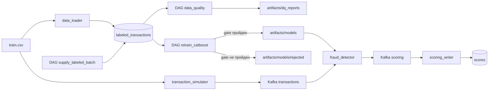

# Антифрод: поток транзакций, скоринг и переобучение в Airflow

Учебный MLOps-проект. Kafka несет непрерывный поток транзакций, сервис `fraud_detector` скорит их текущей моделью CatBoost, а Airflow по расписанию пополняет размеченную витрину, проверяет ее качество и переобучает модель на скользящем окне. Новая модель попадает в прод, только если она не хуже текущей.

Датасет: [teta-ml-1-2025](https://www.kaggle.com/competitions/teta-ml-1-2025/data), файл `train.csv` (786 тыс. размеченных транзакций, 2019-01 - 2020-03, доля фрода около 0.6%).

---

## Архитектура



| Сервис | Назначение |
|--------|------------|
| **zookeeper, kafka, kafka-setup** | Брокер и создание топиков `transactions` и `scoring` |
| **kafka-ui** | Просмотр топиков, http://localhost:8080 |
| **postgres** | Витрина `labeled_transactions`, состояние окна `training_state`, результаты `scores` |
| **data_loader** | Один раз загружает CSV в витрину и задает стартовое окно 2019-01 - 2019-03 |
| **transaction_simulator** | Каждые 0.1 с шлет в Kafka случайную строку CSV с новым `transaction_id` и текущим временем |
| **fraud_detector** | Препроцессинг и инференс. Перед каждым сообщением читает `latest.txt` и при смене версии подгружает модель и ее статистики без перезапуска |
| **scoring_writer** | Пишет `transaction_id, score, fraud_flag, model_version` в таблицу `scores` |
| **airflow** | Три DAG: поставка месяца, Data Quality, переобучение. UI: http://localhost:8081 |

Каталог `./artifacts/models` смонтирован в Airflow как `/opt/airflow/models` и в `fraud_detector` как `/models`. Рядом лежит `./artifacts/dq_reports` с HTML-отчетами Data Quality. Обе папки видны прямо на хосте.

---

## Структура проекта

```
.
|-- dags/
|   |-- retrain_catboost.py        # граф переобучения
|   |-- supply_labeled_batch.py    # граф поставки нового месяца
|   `-- data_quality.py            # граф проверок качества
|-- pipeline/
|   |-- settings.py                # пути и параметры (окно, батч, глубина, gate)
|   |-- db.py                      # работа с витриной и training_state
|   |-- retrain/                   # задачи переобучения
|   |-- supply/                    # задачи поставки месяца
|   `-- dq/                        # правила, проверки и HTML-отчет
|-- fraud_detector/
|   |-- src/preprocessing.py       # препроцессинг, общий для DAG и скоринга
|   |-- src/scorer.py              # загрузка версии модели и инференс
|   `-- models/                    # стартовая модель initial и ее статистики
|-- scripts/train_initial_model.py # переобучение стартовой модели
|-- data_loader/  transaction_simulator/  scoring_writer/  airflow/
|-- docker-compose.yml
`-- .env.example
```

В файлах `dags/` только сборка графа. Каждая задача лежит в отдельном модуле `pipeline/`, в docstring написано, что она читает, что пишет и почему ее повторный запуск не портит данные.

---

## Запуск

Нужны Docker и Docker Compose.

```bash
git clone <URL вашего репозитория>
cd mlops_realtime_fraud_detector_airflow
cp .env.example .env
```

В `.env` укажите в `TRAIN_DATA_CSV` абсолютный путь к `train.csv` на вашей машине. Затем:

```bash
docker compose up -d --build
```

Первый запуск собирает образы и загружает витрину, это занимает несколько минут. Airflow готов, когда открывается UI.

| Что | Где |
|-----|-----|
| Airflow UI | http://localhost:8081, логин `admin`, пароль `admin` |
| Kafka UI | http://localhost:8080 |
| PostgreSQL | `localhost:5432`, база `fraud_db`, `fraud_user` / `fraud_pass` |
| Модели | `./artifacts/models` |
| DQ-отчеты | `./artifacts/dq_reports/latest.html` |

Остановка с полной очисткой витрины, состояния Airflow и моделей:

```bash
docker compose down -v
rm -rf artifacts
```

---

## Параметры

Все значения в `pipeline/settings.py`.

| Параметр | Значение | Смысл |
|----------|----------|-------|
| `WINDOW_MONTHS` | 3 | Длина скользящего окна обучения в месяцах |
| `VALID_FRACTION` | 0.2 | Доля самых поздних строк ранних месяцев окна, которая идет в valid для ранней остановки |
| `SAMPLE_SIZE` | 50 000 | Размер батча, который `supply_labeled_batch` дописывает как новый месяц |
| `HISTORY_YEARS` | 2 | Глубина истории витрины: более старые наблюдения удаляются |
| `GATE_METRIC` | `pr_auc` | Метрика сравнения новой и prod-модели |
| `GATE_TOLERANCE` | 0.0 | Допуск: новая модель публикуется, если ее метрика не ниже prod |

Расписание: `retrain_catboost` и `supply_labeled_batch` раз в 5 минут, `data_quality` раз в 10 минут. У всех `catchup=False` и `max_active_runs=1`, при создании DAG сразу включены.

---

## DAG `supply_labeled_batch`: новый размеченный месяц

```
sample_next_month -> append_labeled_batch -> prune_old_months
```

1. Из витрины случайно берутся 50 000 строк, их `transaction_time` переносится в месяц, следующий за последним в витрине (день, час и минута сохраняются).
2. Батч записывается в витрину. Удаление строк этого месяца и `COPY` идут в одной транзакции, поэтому повтор задачи не задваивает батч.
3. Удаляются строки старше 2 лет от начала самого свежего месяца.

Первый поставленный месяц 2020-04. Окно переобучения идет по историческим месяцам с 2019-04 и отстает от поставки примерно на год, поэтому очистка на 2 года его не задевает.

---

## DAG `retrain_catboost`: переобучение

```
extract_month_batch -> slide_training_window -> clean_dataset -> time_train_test_split
  -> preprocess_dataset -> fit_catboost -> evaluate_champion -> quality_gate
  quality_gate -> publish_model | reject_model -> advance_window
```

| Задача | Что делает |
|--------|-----------|
| `extract_month_batch` | Берет месяц `next_batch_month` из `training_state`. Если его еще нет в витрине, прогон помечается skipped |
| `slide_training_window` | Собирает окно из 3 месяцев, последний из которых новый. Границы считаются только от месяца батча, поэтому повтор не может сдвинуть окно дважды |
| `clean_dataset` | Удаляет строки с пропусками, невалидными target, amount и координатами, дубликаты |
| `time_train_test_split` | Самый свежий месяц идет в test, ранние месяцы по времени делятся на train (80%) и valid (20%). Случайного split нет |
| `preprocess_dataset` | Считает статистики признаков только на train и строит признаки для всех частей |
| `fit_catboost` | Обучает CatBoost с ранней остановкой по valid, test в обучении не участвует. Сохраняет черновик модели |
| `evaluate_champion` | Оценивает текущую prod-модель из `latest.txt` на том же test-месяце |
| `quality_gate` | Выбирает ветку: публикация или отказ |
| `publish_model` | Кладет `my_catboost_<version>.cbm`, `.stats.json`, `.metrics.json` и атомарно переключает `latest.txt` |
| `reject_model` | Кладет те же файлы в `models/rejected/`, `latest.txt` не меняет |
| `advance_window` | Сдвигает `training_state` на следующий месяц. Выполняется только после сохранения модели в одной из веток |

Если прогон упал до `advance_window`, указатель не сдвигается и следующий прогон обучает тот же месяц заново. Если упал сам `advance_window`, его повтор записывает те же значения: указатель вычисляется из месяца батча, а не прибавляется к текущему.

### Препроцессинг

Код в `fraud_detector/src/preprocessing.py` общий для DAG и онлайн-скоринга. Признаки считаются по одной строке, поэтому их можно построить и для батча, и для одного сообщения Kafka.

| Было в коде семинара | Стало | Почему |
|----------------------|-------|--------|
| `year`, `month`, `day`, `minute` | убраны | Поток идет с текущей датой, а модель учится на 2019-2020. Абсолютная дата для деревьев оказывается вне обучающего диапазона, а номер test-месяца никогда не встречается в train |
| `post_code` как число | убран | Это код, а не величина. Местоположение уже задают координаты и штат |
| `weekend` | `day_of_week` | Полный день недели вместо флага |
| `hour` | `hour`, `hour_sin`, `hour_cos`, `is_night` | Цикличность суток и флаг ночной транзакции (22:00 - 05:59) |
| - | `amount_cat_ratio` | Сумма относительно медианы суммы в своей категории `cat_id`. Медианы считаются на train и хранятся вместе с моделью в `my_catboost_<version>.stats.json` |
| - | нормализация категорий | Пропуски в категориях становятся `missing`, `gender` вне M и F становится `unknown` |

Модель и статистики версионируются парой: скоринг загружает обе по версии из `latest.txt`, а `publish_model` переключает `latest.txt` только после того, как оба файла на месте.

Сравнение со старым препроцессингом при одинаковой процедуре обучения, 6 скользящих окон с test-месяцами 2019-04 - 2019-09, среднее:

| Препроцессинг | ROC-AUC | PR-AUC | F1 |
|---------------|---------|--------|----|
| семинар | 0.970 | 0.324 | 0.298 |
| свой | 0.975 | 0.341 | 0.379 |

Стартовая модель `initial` (`fraud_detector/models/my_catboost.cbm`) обучена тем же кодом на окне 2019-01 - 2019-03. Переобучить ее можно так (обучение идет в образе Airflow, чтобы версия CatBoost совпала с контейнерами):

```bash
docker compose run --rm --no-deps --entrypoint python \
  -v "$PWD:/repo" -v "/путь/к/train.csv:/data/train.csv:ro" \
  airflow /repo/scripts/train_initial_model.py --csv /data/train.csv --out-dir /repo/fraud_detector/models
```

### Проверка улучшения модели (quality gate)

- **Что сравниваем.** Новую модель и текущую prod-модель из `latest.txt` на одном и том же свежем test-месяце. Ни одна из них его не видела: prod-модель обучена на окне, которое закончилось раньше. Метрики из старых `metrics.json` не используются, потому что они посчитаны на другом месяце и несравнимы.
- **Какая метрика.** PR-AUC (average precision). Фрода около 0.6%, ROC-AUC у всех моделей держится в районе 0.97-0.98 и плохо их различает, а PR-AUC показывает качество именно на редком положительном классе и не зависит от порога.
- **Правило.** Новая модель публикуется, если `pr_auc_new >= pr_auc_prod - GATE_TOLERANCE` (допуск 0). Если prod-модели нет, новая публикуется. Если в test-месяце один класс и PR-AUC не определен, модель не публикуется.
- **Что дальше.** Отклоненная модель сохраняется в `artifacts/models/rejected/` вместе с метриками обеих моделей и причиной, `latest.txt` не меняется, скоринг продолжает работать на старой версии. Окно все равно сдвигается: месяц уже использован, а без сдвига DAG бесконечно переобучался бы на одних и тех же данных.

Решение видно в логе задачи `quality_gate`, в графе (одна из веток `publish_model` или `reject_model` помечена skipped) и в поле `decision` файла `metrics.json`.

---

## DAG `data_quality`: проверки витрины

```
check_completeness \
check_validity      --> render_report -> publish_report
check_consistency  /
```

Правила считаются SQL-агрегатами прямо в Postgres. Нарушения не роняют DAG: статус каждого правила виден в отчете. Отчет публикуется в `artifacts/dq_reports/dq_report_<ts>.html`, последний дополнительно копируется в `latest.html`.

| Правило | Группа | Важность | Требование |
|---------|--------|----------|------------|
| `completeness` | completeness | critical | Нет NULL в `transaction_time`, `amount`, `merch`, `cat_id`, координатах и `target` |
| `target_domain` | validity | critical | `target` только 0 или 1 |
| `amount_range` | validity | critical | `0 < amount <= 30000` |
| `coordinates_range` | validity | critical | Широта клиента и мерчанта в [-90, 90], долгота в [-180, 180] |
| `gender_domain` | validity | warning | `gender` только M или F |
| `duplicates` | consistency | warning | Полных дубликатов строк не больше 0.1% |
| `monthly_volume` | consistency | critical | Нет пропущенных месяцев, в каждом месяце не меньше 10 000 строк |
| `fraud_rate_per_month` | consistency | warning | Доля фрода каждого месяца в [0.1%, 3%] |
| `history_depth` | consistency | warning | Нет наблюдений старше 2 лет от самого свежего месяца (проверка работы очистки) |

Статус правила: PASS, если доля нарушений не выше порога, иначе FAIL для critical и WARN для warning.

---

## Как проверить работу

1. Откройте Airflow (http://localhost:8081, `admin` / `admin`). Должны быть видны три DAG: `retrain_catboost`, `supply_labeled_batch`, `data_quality`. На вкладке Graph видны цепочки задач.
2. Запустите `retrain_catboost` кнопкой Trigger DAG (или подождите расписания). Прогон должен завершиться со статусом success. Можно запустить из терминала:
   ```bash
   docker compose exec airflow airflow dags trigger retrain_catboost
   ```
3. Проверьте, что появился новый файл модели и на какую версию указывает прод:
   ```bash
   ls -la artifacts/models artifacts/models/rejected
   cat artifacts/models/latest.txt
   cat artifacts/models/my_catboost_*.metrics.json
   ```
   В `metrics.json` есть месяцы train и test, метрики новой и prod-модели и решение gate.
4. Проверьте, что окно сдвинулось:
   ```bash
   docker compose exec postgres psql -U fraud_user -d fraud_db -c "SELECT * FROM training_state;"
   ```
5. Убедитесь, что новые транзакции скорятся опубликованной версией. Версия есть в каждом сообщении топика `scoring` (Kafka UI) и в таблице `scores`:
   ```bash
   docker compose exec postgres psql -U fraud_user -d fraud_db -c \
     "SELECT model_version, count(*), min(created_at), max(created_at) FROM scores GROUP BY 1 ORDER BY 3;"
   ```
   Последняя по времени версия совпадает с `latest.txt`. Контейнер `fraud_detector` при этом не перезапускался, переключение видно в его логе:
   ```bash
   docker compose logs fraud_detector | grep "Загружена модель"
   ```
6. Запустите `supply_labeled_batch` и проверьте, что в витрине появился новый месяц на 50 000 строк:
   ```bash
   docker compose exec postgres psql -U fraud_user -d fraud_db -c \
     "SELECT date_trunc('month', transaction_time) AS month, count(*) FROM labeled_transactions GROUP BY 1 ORDER BY 1 DESC LIMIT 3;"
   ```
7. Запустите `data_quality` и откройте в браузере `artifacts/dq_reports/latest.html`.
